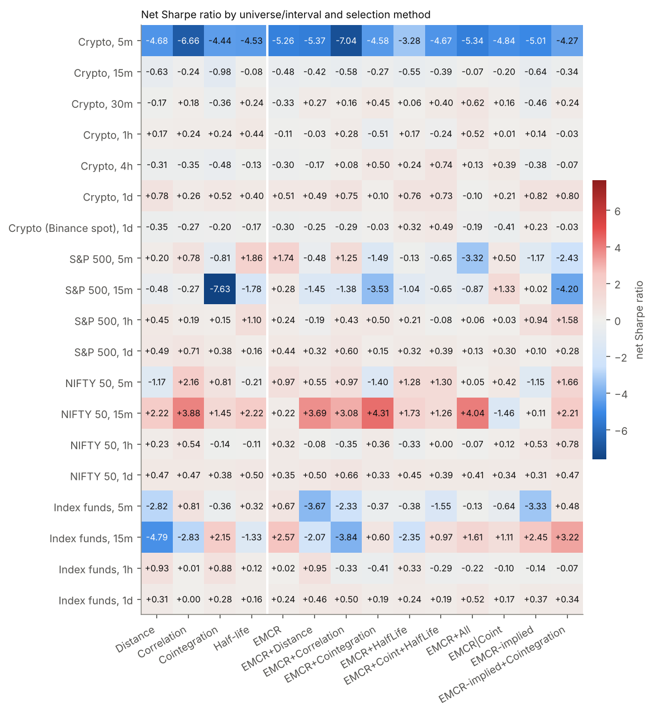

# EMCR pair selection: results (protocol v4.2)

All numbers are out of sample (non-overlapping walk-forward windows of 630 formation + 315 trading bars), net of venue-specific costs. The trading rule is identical for every selection method, so differences measure pair selection only.

**Fixed strategy.** Price ratio r = P_A/P_B; z = (r - MA_140)/SD_140; enter at |z| >= 2, exit at |z| <= 0.5; top 20 pairs, no security reused; capital rank-weighted by selection score (fixed for the window); costs: crypto 6 bps per side + actual funding, S&P 500 3 bps + 0.5%/yr borrow, NIFTY 50 5 bps, ETFs 1.5 bps + 0.3%/yr borrow.

## 1. Data and walk-forward windows

| dataset | folds | first | last | names | pairs | ranked |
|---|---|---|---|---|---|---|
| crypto_5m | 581 | 2025-01-03 | 2026-09-30 | 94 | 4443 | True |
| crypto_15m | 747 | 2020-01-14 | 2026-09-30 | 90 | 4245 | True |
| crypto_30m | 372 | 2020-01-20 | 2026-09-26 | 89 | 4219 | True |
| crypto_1h | 184 | 2020-02-09 | 2026-09-20 | 90 | 4256 | True |
| crypto_4h | 43 | 2020-06-06 | 2026-08-11 | 89 | 4205 | True |
| crypto_1d | 4 | 2022-08-03 | 2026-01-13 | 92 | 4299 | False |
| crypto_spot_1d | 7 | 2020-03-19 | 2026-04-01 | 76 | 3373 | True |
| sp500_5m | 12 | 2026-08-19 | 2026-10-27 | 493 | 13329 | True |
| sp500_15m | 2 | 2026-09-11 | 2026-10-15 | 496 | 13490 | False |
| sp500_1h | 14 | 2024-04-15 | 2026-10-23 | 465 | 11740 | True |
| sp500_1d | 15 | 2007-07-06 | 2026-04-16 | 311 | 5533 | True |
| nifty50_5m | 11 | 2026-08-17 | 2026-10-26 | 49 | 1176 | True |
| nifty50_15m | 2 | 2026-09-09 | 2026-10-16 | 49 | 1176 | False |
| nifty50_1h | 14 | 2024-04-01 | 2026-10-26 | 49 | 1159 | True |
| nifty50_1d | 12 | 2010-07-27 | 2025-11-19 | 44 | 967 | True |
| etf_5m | 12 | 2026-08-19 | 2026-10-27 | 68 | 2290 | True |
| etf_15m | 2 | 2026-09-11 | 2026-10-15 | 68 | 2278 | False |
| etf_1h | 14 | 2024-04-15 | 2026-10-23 | 69 | 2336 | True |
| etf_1d | 15 | 2007-07-06 | 2026-04-16 | 76 | 2905 | True |

Datasets with fewer than 5 windows are shown but excluded from rankings and test families.

## 2. Net Sharpe ratio by dataset and selection method

| dataset | Distance | Correlation | Cointegration | HalfLife | EMCR | EMCR+Distance | EMCR+Correlation | EMCR+Cointegration | EMCR+HalfLife | EMCR+Coint+HalfLife | EMCR+All | EMCR|Coint | EMCR-implied | EMCR-implied+Cointegration |
|---|---|---|---|---|---|---|---|---|---|---|---|---|---|---|
| crypto_5m | -4.68 | -6.66 | -4.44 | -4.53 | -5.26 | -5.37 | -7.04 | -4.58 | -3.28 | -4.67 | -5.34 | -4.84 | -5.01 | -4.27 |
| crypto_15m | -0.63 | -0.24 | -0.98 | -0.08 | -0.48 | -0.42 | -0.58 | -0.27 | -0.55 | -0.39 | -0.07 | -0.20 | -0.64 | -0.34 |
| crypto_30m | -0.17 | 0.18 | -0.36 | 0.24 | -0.33 | 0.27 | 0.16 | 0.45 | 0.06 | 0.40 | 0.62 | 0.16 | -0.46 | 0.24 |
| crypto_1h | 0.17 | 0.24 | 0.24 | 0.44 | -0.11 | -0.03 | 0.28 | -0.51 | 0.17 | -0.24 | 0.52 | 0.01 | 0.14 | -0.03 |
| crypto_4h | -0.31 | -0.35 | -0.48 | -0.13 | -0.30 | -0.17 | 0.08 | 0.50 | 0.24 | 0.74 | 0.13 | 0.39 | -0.38 | -0.07 |
| crypto_1d | 0.78 | 0.26 | 0.52 | 0.40 | 0.51 | 0.49 | 0.75 | 0.10 | 0.76 | 0.73 | -0.10 | 0.21 | 0.82 | 0.80 |
| crypto_spot_1d | -0.35 | -0.27 | -0.20 | -0.17 | -0.30 | -0.25 | -0.29 | -0.03 | 0.32 | 0.49 | -0.19 | -0.41 | 0.23 | -0.03 |
| sp500_5m | 0.20 | 0.78 | -0.81 | 1.86 | 1.74 | -0.48 | 1.25 | -1.49 | -0.13 | -0.65 | -3.32 | 0.50 | -1.17 | -2.43 |
| sp500_15m | -0.48 | -0.27 | -7.63 | -1.78 | 0.28 | -1.45 | -1.38 | -3.53 | -1.04 | -0.65 | -0.87 | 1.33 | 0.02 | -4.20 |
| sp500_1h | 0.45 | 0.19 | 0.15 | 1.10 | 0.24 | -0.19 | 0.43 | 0.50 | 0.21 | -0.08 | 0.06 | 0.03 | 0.94 | 1.58 |
| sp500_1d | 0.49 | 0.71 | 0.38 | 0.16 | 0.44 | 0.32 | 0.60 | 0.15 | 0.32 | 0.39 | 0.13 | 0.30 | 0.10 | 0.28 |
| nifty50_5m | -1.17 | 2.16 | 0.81 | -0.21 | 0.97 | 0.55 | 0.97 | -1.40 | 1.28 | 1.30 | 0.05 | 0.42 | -1.15 | 1.66 |
| nifty50_15m | 2.22 | 3.88 | 1.45 | 2.22 | 0.22 | 3.69 | 3.08 | 4.31 | 1.73 | 1.26 | 4.04 | -1.46 | 0.11 | 2.21 |
| nifty50_1h | 0.23 | 0.54 | -0.14 | -0.11 | 0.32 | -0.08 | -0.35 | 0.36 | -0.33 | 0.00 | -0.07 | 0.12 | 0.53 | 0.78 |
| nifty50_1d | 0.47 | 0.47 | 0.38 | 0.50 | 0.35 | 0.50 | 0.66 | 0.33 | 0.45 | 0.39 | 0.41 | 0.34 | 0.31 | 0.47 |
| etf_5m | -2.82 | 0.81 | -0.36 | 0.32 | 0.67 | -3.67 | -2.33 | -0.37 | -0.38 | -1.55 | -0.13 | -0.64 | -3.33 | 0.48 |
| etf_15m | -4.79 | -2.83 | 2.15 | -1.33 | 2.57 | -2.07 | -3.84 | 0.60 | -2.35 | 0.97 | 1.61 | 1.11 | 2.45 | 3.22 |
| etf_1h | 0.93 | 0.01 | 0.88 | 0.12 | 0.02 | 0.95 | -0.33 | -0.41 | 0.33 | -0.29 | -0.22 | -0.10 | -0.14 | -0.07 |
| etf_1d | 0.31 | 0.00 | 0.28 | 0.16 | 0.24 | 0.46 | 0.50 | 0.19 | 0.24 | 0.19 | 0.52 | 0.17 | 0.37 | 0.34 |

## 3. Ranking of selection methods (datasets with >= 5 windows)

| criterion | mean_sharpe | median_sharpe | share_positive | mean_rank | times_best |
|---|---|---|---|---|---|
| EMCR-implied+Cointegration | -0.09 | 0.24 | 0.53 | 5.53 | 2 |
| HalfLife | -0.02 | 0.16 | 0.60 | 5.87 | 1 |
| Correlation | -0.09 | 0.19 | 0.73 | 6.27 | 3 |
| EMCR+HalfLife | -0.07 | 0.21 | 0.67 | 6.67 | 1 |
| EMCR+All | -0.46 | 0.05 | 0.53 | 7.20 | 4 |
| EMCR+Coint+HalfLife | -0.27 | 0.00 | 0.53 | 7.40 | 2 |
| EMCR+Correlation | -0.40 | 0.16 | 0.60 | 7.47 | 1 |
| EMCR | -0.12 | 0.24 | 0.60 | 7.73 | 0 |
| Distance | -0.46 | 0.17 | 0.53 | 7.93 | 0 |
| EMCR+Distance | -0.51 | -0.08 | 0.40 | 8.13 | 1 |
| EMCR+Cointegration | -0.44 | -0.03 | 0.47 | 8.13 | 0 |
| Cointegration | -0.31 | -0.14 | 0.47 | 8.47 | 0 |
| EMCR|Coint | -0.25 | 0.12 | 0.67 | 8.60 | 0 |
| EMCR-implied | -0.64 | -0.14 | 0.47 | 9.60 | 0 |

## 4. Does adding EMCR improve each classical method?

| hybrid | component | datasets | hybrid_better | median_sharpe_gain | mean_sharpe_gain |
|---|---|---|---|---|---|
| EMCR+Distance | Distance | 15 | 8 | 0.02 | -0.05 |
| EMCR+Correlation | Correlation | 15 | 6 | -0.03 | -0.31 |
| EMCR+Cointegration | Cointegration | 15 | 6 | -0.04 | -0.13 |
| EMCR+HalfLife | HalfLife | 15 | 7 | -0.05 | -0.05 |
| EMCR+Coint+HalfLife | Cointegration | 15 | 9 | 0.01 | 0.04 |
| EMCR+All | Cointegration | 15 | 9 | 0.03 | -0.15 |
| EMCR|Coint | Cointegration | 15 | 5 | -0.10 | 0.06 |
| EMCR-implied | Cointegration | 15 | 6 | -0.09 | -0.33 |
| EMCR-implied+Cointegration | Cointegration | 15 | 11 | 0.17 | 0.22 |

## 5. Pre-registered Diebold-Mariano tests (primary configuration)

d_t = n^A_t - n^B_t (net return of A minus B per bar); H0: E[d] = 0, two-sided; Newey-West HAC with Bartlett kernel, bandwidth floor(4(T/100)^(2/9)) (also 2x and Andrews 1991 shown), Harvey-Leybourne-Newbold correction, t(T-1) reference; stationary-bootstrap p-value with Politis-White block length; Holm within dataset and across all datasets.

Tests: 195; significant at 5% after Holm across all: 0.

| dataset | A | B | dm_nw | p_nw | p_nw2 | p_andrews | p_boot | lag_nw | mean_diff_pa | holm_within | holm_all |
|---|---|---|---|---|---|---|---|---|---|---|---|
| etf_1h | EMCR+Cointegration | Cointegration | -3.2471 | 0.0012 | 0.0016 | 0.0012 | 0.0020 | 9 | -0.0321 | 0.0153 | 0.2290 |
| crypto_4h | EMCR+Coint+HalfLife | Cointegration | 3.1926 | 0.0014 | 0.0015 | 0.0010 | 0.0015 | 11 | 0.1269 | 0.0184 | 0.2742 |
| crypto_15m | EMCR+All | Cointegration | 2.8228 | 0.0048 | 0.0046 | 0.0054 | 0.0050 | 22 | 0.1229 | 0.0619 | 0.9188 |
| etf_1d | EMCR+Correlation | Correlation | 2.6754 | 0.0075 | 0.0058 | 0.0123 | 0.0160 | 9 | 0.0072 | 0.0974 | 1.0000 |
| crypto_30m | EMCR+All | Cointegration | 2.6390 | 0.0083 | 0.0080 | 0.0085 | 0.0065 | 19 | 0.1108 | 0.1081 | 1.0000 |
| crypto_4h | EMCR+Cointegration | Cointegration | 2.6327 | 0.0085 | 0.0092 | 0.0077 | 0.0095 | 11 | 0.1061 | 0.1018 | 1.0000 |
| etf_1h | EMCR+Coint+HalfLife | Cointegration | -2.6125 | 0.0090 | 0.0110 | 0.0089 | 0.0080 | 9 | -0.0292 | 0.1082 | 1.0000 |
| crypto_30m | EMCR+Cointegration | Cointegration | 2.5563 | 0.0106 | 0.0104 | 0.0107 | 0.0095 | 19 | 0.1007 | 0.1270 | 1.0000 |
| etf_1h | EMCR|Coint | Cointegration | -2.5481 | 0.0109 | 0.0133 | 0.0109 | 0.0135 | 9 | -0.0247 | 0.1195 | 1.0000 |
| etf_1h | EMCR-implied+Cointegration | Cointegration | -2.4000 | 0.0164 | 0.0156 | 0.0240 | 0.0235 | 9 | -0.0240 | 0.1643 | 1.0000 |
| crypto_30m | EMCR+Coint+HalfLife | Cointegration | 2.3975 | 0.0165 | 0.0164 | 0.0168 | 0.0150 | 19 | 0.0946 | 0.1816 | 1.0000 |
| crypto_15m | EMCR+Cointegration | Cointegration | 2.3305 | 0.0198 | 0.0186 | 0.0211 | 0.0210 | 22 | 0.0966 | 0.2374 | 1.0000 |
| crypto_spot_1d | EMCR+Coint+HalfLife | Cointegration | 2.3112 | 0.0209 | 0.0194 | 0.0215 | 0.0215 | 7 | 0.0727 | 0.2719 | 1.0000 |
| crypto_15m | EMCR|Coint | Cointegration | 2.2993 | 0.0215 | 0.0210 | 0.0222 | 0.0195 | 22 | 0.1038 | 0.2374 | 1.0000 |
| etf_1h | EMCR+All | Cointegration | -2.2537 | 0.0243 | 0.0223 | 0.0311 | 0.0305 | 9 | -0.0259 | 0.2184 | 1.0000 |
| crypto_1h | EMCR+Cointegration | Cointegration | -2.2279 | 0.0259 | 0.0231 | 0.0324 | 0.0260 | 16 | -0.0863 | 0.3366 | 1.0000 |
| crypto_4h | EMCR|Coint | Cointegration | 2.2133 | 0.0269 | 0.0276 | 0.0249 | 0.0260 | 11 | 0.0953 | 0.2958 | 1.0000 |
| etf_1h | EMCR-implied | Cointegration | -2.1821 | 0.0292 | 0.0246 | 0.0351 | 0.0295 | 9 | -0.0259 | 0.2333 | 1.0000 |
| crypto_15m | EMCR-implied+Cointegration | Cointegration | 2.1758 | 0.0296 | 0.0286 | 0.0319 | 0.0315 | 22 | 0.0865 | 0.2957 | 1.0000 |
| crypto_15m | EMCR+Coint+HalfLife | Cointegration | 2.0121 | 0.0442 | 0.0416 | 0.0484 | 0.0485 | 22 | 0.0828 | 0.3979 | 1.0000 |
| crypto_5m | EMCR | Correlation | -1.9539 | 0.0507 | 0.0514 | 0.0512 | 0.0530 | 21 | -0.1906 | 0.6593 | 1.0000 |
| crypto_30m | EMCR-implied+Cointegration | Cointegration | 1.8658 | 0.0621 | 0.0638 | 0.0607 | 0.0600 | 19 | 0.0752 | 0.6207 | 1.0000 |
| nifty50_1h | EMCR-implied+Cointegration | Cointegration | 1.8030 | 0.0715 | 0.0624 | 0.0803 | 0.0780 | 9 | 0.0264 | 0.9290 | 1.0000 |
| crypto_15m | EMCR+HalfLife | HalfLife | -1.7517 | 0.0798 | 0.0805 | 0.0807 | 0.0870 | 22 | -0.0577 | 0.6387 | 1.0000 |
| sp500_1h | EMCR-implied+Cointegration | Cointegration | 1.7318 | 0.0834 | 0.0816 | 0.0895 | 0.0930 | 9 | 0.0396 | 1.0000 | 1.0000 |

## 6. Pair-level evidence: does the formation statistic predict a pair's out-of-sample net return? (t-statistic of the fold-average rank IC)

| dataset | ar1 | ccr | coint_p | corr | distance | halflife | mcr |
|---|---|---|---|---|---|---|---|
| crypto_5m | -3.3 | -2.9 | -5.0 | -15.0 | -14.5 | -3.1 | -5.1 |
| crypto_15m | 5.8 | 3.4 | 4.6 | -7.3 | -2.8 | 4.8 | 3.8 |
| crypto_30m | 4.1 | 1.7 | 2.9 | -6.1 | -2.2 | 3.4 | 2.6 |
| crypto_1h | 3.9 | 0.9 | 4.1 | -2.6 | -1.2 | 3.0 | 1.6 |
| crypto_4h | 4.2 | 3.0 | 2.1 | -1.0 | 0.1 | 2.4 | 2.2 |
| crypto_1d | 9.0 | 7.3 | 2.8 | 0.9 | 1.4 | 3.1 | 2.5 |
| crypto_spot_1d | 5.4 | 0.7 | 1.1 | -0.4 | -0.1 | 1.3 | 2.9 |
| sp500_5m | -0.9 | -0.7 | -0.1 | -0.6 | -0.7 | 0.3 | -0.1 |
| sp500_15m | -0.2 | 0.1 | -1.5 | 0.5 | 0.6 | 2.5 | 0.4 |
| sp500_1h | -0.7 | -0.9 | -3.6 | -2.0 | -1.6 | -1.5 | -1.2 |
| sp500_1d | 2.3 | 1.2 | 0.4 | -1.9 | -0.9 | 1.2 | -0.1 |
| nifty50_5m | 1.4 | 0.6 | 2.5 | -0.5 | -1.4 | -0.1 | 0.5 |
| nifty50_15m | 0.1 | 0.1 | 0.1 | 0.4 | 0.7 | -0.9 | -0.1 |
| nifty50_1h | -0.5 | 0.2 | -1.2 | -0.8 | -0.6 | -1.1 | -1.1 |
| nifty50_1d | 3.6 | 1.9 | 1.6 | -0.9 | 3.7 | 4.0 | 3.1 |
| etf_5m | -0.3 | 0.5 | 0.5 | -2.1 | -1.4 | 0.4 | -0.2 |
| etf_15m | 0.8 | -0.2 | 0.4 | -2.0 | -0.2 | -0.1 | 0.2 |
| etf_1h | -0.7 | -0.4 | -0.9 | -1.3 | -0.5 | -0.9 | -1.0 |
| etf_1d | 0.5 | -2.4 | -0.2 | -0.5 | -1.6 | -2.0 | -1.1 |

`mcr` = EMCR, `ar1` = lag-1 autocorrelation of z (oriented: lower is better; equivalent to the arcsine-implied EMCR), others as named.

## 7. Data-snooping checks

| dataset | K | T | spa_p | rc_p |
|---|---|---|---|---|
| crypto_5m | 50 | 636 | 0.565 | 0.565 |
| crypto_15m | 50 | 2452 | 0.434 | 0.434 |
| crypto_30m | 50 | 2442 | 0.392 | 0.392 |
| crypto_1h | 140 | 2416 | 0.900 | 0.908 |
| crypto_4h | 140 | 2258 | 0.281 | 0.281 |
| crypto_1d | 140 | 1260 | 0.755 | 0.755 |
| crypto_spot_1d | 140 | 2205 | 0.324 | 0.346 |
| sp500_5m | 140 | 49 | 0.084 | 0.084 |
| sp500_15m | 140 | 25 | 0.399 | 0.399 |
| sp500_1h | 140 | 635 | 0.326 | 0.326 |
| sp500_1d | 140 | 4725 | 0.422 | 0.422 |
| nifty50_5m | 140 | 48 | 0.287 | 0.287 |
| nifty50_15m | 140 | 26 | 0.216 | 0.216 |
| nifty50_1h | 140 | 634 | 0.598 | 0.743 |
| nifty50_1d | 140 | 3780 | 0.178 | 0.178 |
| etf_5m | 140 | 49 | 0.786 | 0.793 |
| etf_15m | 140 | 25 | 0.440 | 0.440 |
| etf_1h | 140 | 635 | 0.776 | 0.788 |
| etf_1d | 140 | 4725 | 0.621 | 0.621 |

Deflated Sharpe ratio (Bailey and Lopez de Prado 2014) of the best proposed configuration in each dataset's sensitivity grid:

| dataset | config | criterion | sr | sr0 | dsr | psr | N |
|---|---|---|---|---|---|---|---|
| crypto_5m | LEVEL|w140|e2|x0.5|n20|rank | EMCR+HalfLife | -0.117 | 0.553 | 0.000 | 0.090 | 70 |
| crypto_15m | LEVEL|w140|e2|x0.5|n20|rank | EMCR+All | -0.003 | 0.183 | 0.000 | 0.436 | 70 |
| crypto_30m | LEVEL|w140|e2|x0.5|n20|rank | EMCR+All | 0.031 | 0.109 | 0.000 | 0.948 | 70 |
| crypto_1h | LEVEL|w140|e2|x0.5|n5|rank | EMCR+All | 0.058 | 0.085 | 0.089 | 0.998 | 196 |
| crypto_4h | LEVEL|w140|e2|x1|n20|rank | EMCR+Coint+HalfLife | 0.057 | 0.058 | 0.473 | 0.997 | 196 |
| crypto_1d | LEVEL|w140|e2|x0.5|n5|rank | EMCR+Correlation | 0.079 | 0.057 | 0.777 | 0.997 | 196 |
| crypto_spot_1d | LEVEL|w140|e2|x0.5|n5|rank | EMCR+HalfLife | 0.045 | 0.049 | 0.434 | 0.990 | 196 |
| sp500_5m | LEVEL|w140|e2|x0.5|n5|rank | EMCR+Coint+HalfLife | 0.414 | 0.444 | 0.414 | 0.998 | 196 |
| sp500_15m | LEVEL|w140|e2|x1|n20|rank | EMCR|Coint | 0.314 | 0.509 | 0.158 | 0.948 | 196 |
| sp500_1h | LEVEL|w140|e2|x0|n20|rank | EMCR-implied+Cointegration | 0.120 | 0.094 | 0.747 | 0.999 | 196 |
| sp500_1d | LEVEL|w70|e2|x0.5|n20|rank | EMCR+Correlation | 0.050 | 0.035 | 0.861 | 1.000 | 196 |
| nifty50_5m | LEVEL|w140|e2|x0.5|n10|rank | EMCR | 0.239 | 0.431 | 0.094 | 0.951 | 196 |
| nifty50_15m | LEVEL|w280|e2|x0.5|n20|rank | EMCR-implied | 0.545 | 0.399 | 0.742 | 0.992 | 196 |
| nifty50_1h | LEVEL|w140|e2.5|x0.5|n20|rank | EMCR-implied+Cointegration | 0.064 | 0.093 | 0.227 | 0.951 | 196 |
| nifty50_1d | LEVEL|w70|e2|x0.5|n20|rank | EMCR+Correlation | 0.051 | 0.038 | 0.789 | 0.999 | 196 |
| etf_5m | LEVEL|w140|e2.5|x0.5|n20|rank | EMCR | 0.188 | 0.512 | 0.012 | 0.904 | 196 |
| etf_15m | LEVEL|w140|e2|x0.5|n10|rank | EMCR-implied+Cointegration | 0.395 | 0.461 | 0.356 | 0.986 | 196 |
| etf_1h | LEVEL|w140|e2|x0|n20|rank | EMCR+Distance | 0.082 | 0.084 | 0.486 | 0.981 | 196 |
| etf_1d | LEVEL|w140|e2|x0.5|n10|rank | EMCR+All | 0.054 | 0.034 | 0.924 | 1.000 | 196 |

## 7b. Execution-delay robustness (decision at bar t, trade at bar t+1)

| Unnamed: 0 | no_delay_mean | delay1_mean | best_delay1 | best_delay1_sharpe |
|---|---|---|---|---|
| crypto_1h | 0.09 | -0.74 | EMCR+All | -0.29 |
| crypto_4h | -0.01 | -0.25 | EMCR+Coint+HalfLife | 0.39 |
| crypto_1d | 0.50 | 0.49 | EMCR+HalfLife | 0.96 |
| crypto_spot_1d | -0.10 | -0.26 | EMCR+Coint+HalfLife | 0.27 |
| sp500_5m | -0.30 | -3.54 | HalfLife | -1.01 |
| sp500_1h | 0.40 | 0.13 | EMCR-implied+Cointegration | 1.12 |
| sp500_1d | 0.34 | 0.27 | Correlation | 0.65 |
| nifty50_5m | 0.45 | -3.91 | Cointegration | -2.44 |
| nifty50_1h | 0.13 | 0.02 | EMCR-implied+Cointegration | 0.74 |
| nifty50_1d | 0.43 | 0.31 | EMCR+Correlation | 0.50 |
| etf_5m | -0.95 | -1.78 | EMCR | 0.47 |
| etf_1h | 0.12 | 0.03 | Distance | 0.88 |
| etf_1d | 0.28 | 0.15 | EMCR+All | 0.33 |

Sharpe by method with a one-bar delay:

| dataset | Distance | Correlation | Cointegration | HalfLife | EMCR | EMCR+Distance | EMCR+Correlation | EMCR+Cointegration | EMCR+HalfLife | EMCR+Coint+HalfLife | EMCR+All | EMCR|Coint | EMCR-implied | EMCR-implied+Cointegration |
|---|---|---|---|---|---|---|---|---|---|---|---|---|---|---|
| crypto_1h | -0.65 | -0.72 | -0.54 | -0.33 | -1.02 | -0.75 | -0.51 | -1.29 | -0.68 | -1.12 | -0.29 | -0.81 | -0.68 | -0.95 |
| crypto_4h | -0.58 | -0.69 | -0.66 | -0.44 | -0.46 | -0.56 | -0.22 | 0.36 | -0.03 | 0.39 | -0.20 | 0.20 | -0.43 | -0.15 |
| crypto_1d | 0.72 | 0.35 | 0.55 | 0.44 | 0.49 | 0.28 | 0.75 | -0.11 | 0.96 | 0.77 | -0.16 | 0.33 | 0.84 | 0.72 |
| crypto_spot_1d | -0.44 | -0.44 | -0.27 | -0.24 | -0.60 | -0.38 | -0.56 | -0.22 | 0.16 | 0.27 | -0.30 | -0.42 | 0.04 | -0.17 |
| sp500_5m | -5.18 | -1.89 | -2.26 | -1.01 | -1.37 | -5.94 | -4.46 | -3.97 | -3.25 | -3.28 | -8.73 | -1.76 | -2.83 | -3.59 |
| sp500_1h | -0.22 | -0.49 | 0.02 | 0.82 | 0.17 | -0.24 | 0.15 | 0.21 | -0.00 | -0.29 | -0.11 | -0.23 | 0.87 | 1.12 |
| sp500_1d | 0.36 | 0.65 | 0.36 | 0.16 | 0.37 | 0.30 | 0.54 | 0.07 | 0.25 | 0.35 | 0.03 | 0.19 | -0.03 | 0.17 |
| nifty50_5m | -4.89 | -3.10 | -2.44 | -4.94 | -3.30 | -4.05 | -4.59 | -5.01 | -3.88 | -3.53 | -3.76 | -2.80 | -5.89 | -2.59 |
| nifty50_1h | 0.12 | 0.35 | -0.04 | -0.25 | 0.05 | -0.28 | -0.60 | 0.39 | -0.48 | -0.13 | -0.25 | 0.16 | 0.53 | 0.74 |
| nifty50_1d | 0.41 | 0.30 | 0.26 | 0.38 | 0.25 | 0.41 | 0.50 | 0.21 | 0.25 | 0.27 | 0.29 | 0.21 | 0.23 | 0.35 |
| etf_5m | -4.07 | -1.01 | -1.39 | 0.11 | 0.47 | -4.85 | -3.37 | -0.98 | -0.59 | -2.01 | -0.22 | -1.06 | -5.15 | -0.78 |
| etf_1h | 0.88 | -0.11 | 0.82 | 0.01 | -0.12 | 0.74 | -0.49 | -0.38 | 0.19 | -0.31 | -0.30 | -0.17 | -0.26 | -0.03 |
| etf_1d | 0.11 | -0.17 | 0.20 | 0.05 | 0.09 | 0.29 | 0.30 | 0.13 | 0.13 | 0.10 | 0.33 | 0.06 | 0.25 | 0.20 |

## 8. Costs: break-even one-way cost (bps) and turnover (x capital per year)

| dataset | Distance | Correlation | Cointegration | HalfLife | EMCR | EMCR+Distance | EMCR+Correlation | EMCR+Cointegration | EMCR+HalfLife | EMCR+Coint+HalfLife | EMCR+All | EMCR|Coint | EMCR-implied | EMCR-implied+Cointegration |
|---|---|---|---|---|---|---|---|---|---|---|---|---|---|---|
| crypto_5m | 2.3 | 2.4 | 1.7 | 2.2 | 1.6 | 2.2 | 2.3 | 1.8 | 2.8 | 2.1 | 2.5 | 1.7 | 1.6 | 2.0 |
| crypto_15m | 5.2 | 5.7 | 4.4 | 5.9 | 5.3 | 5.5 | 5.3 | 5.6 | 5.2 | 5.4 | 5.9 | 5.7 | 5.0 | 5.5 |
| crypto_30m | 5.6 | 6.4 | 4.9 | 6.7 | 5.0 | 6.7 | 6.4 | 7.3 | 6.2 | 7.1 | 7.5 | 6.4 | 4.7 | 6.7 |
| crypto_1h | 6.8 | 7.0 | 7.3 | 8.3 | 5.4 | 5.9 | 7.2 | 3.3 | 6.9 | 4.8 | 8.4 | 6.1 | 6.8 | 5.9 |
| crypto_4h | 1.2 | 1.3 |  | 3.8 | 1.0 | 3.2 | 7.1 | 14.5 | 10.0 | 17.7 | 8.0 | 12.8 |  | 4.9 |
| crypto_1d | 51.3 | 20.5 | 41.6 | 33.4 | 42.1 | 35.6 | 44.6 | 13.5 | 57.8 | 53.7 |  | 20.5 | 61.9 | 59.4 |
| crypto_spot_1d |  |  |  |  |  |  |  | 8.9 | 36.7 | 48.2 |  |  | 29.9 | 8.4 |
| sp500_5m | 3.1 | 3.4 | 2.2 | 4.2 | 4.1 | 2.8 | 3.4 | 2.1 | 2.9 | 2.6 | 1.5 | 3.3 | 2.0 | 0.7 |
| sp500_15m | 2.7 | 2.8 |  |  | 3.6 | 1.2 | 1.7 |  | 1.0 | 1.6 | 2.0 | 5.4 | 3.0 |  |
| sp500_1h | 4.9 | 3.7 | 4.5 | 10.9 | 4.8 | 2.0 | 4.9 | 6.7 | 4.6 | 2.4 | 3.3 | 3.2 | 11.3 | 14.5 |
| sp500_1d | 18.2 | 27.0 | 21.7 | 10.7 | 25.9 | 17.7 | 26.0 | 10.1 | 17.0 | 19.3 | 9.2 | 16.9 | 8.2 | 14.7 |
| nifty50_5m | 4.1 | 6.3 | 5.7 | 4.8 | 5.7 | 5.5 | 5.6 | 3.8 | 6.0 | 6.0 | 5.0 | 5.3 | 4.1 | 6.3 |
| nifty50_15m | 9.0 | 11.8 | 7.9 | 9.3 | 5.4 | 12.3 | 10.3 | 12.9 | 8.5 | 7.6 | 12.2 | 1.8 | 5.2 | 9.2 |
| nifty50_1h | 6.7 | 8.2 | 3.8 | 4.1 | 7.6 | 4.4 | 2.6 | 8.0 | 2.4 | 5.0 | 4.5 | 6.1 | 8.9 | 11.1 |
| nifty50_1d | 28.0 | 24.6 | 24.7 | 29.3 | 23.6 | 29.4 | 34.5 | 22.0 | 28.1 | 25.1 | 24.3 | 24.2 | 21.3 | 29.2 |
| etf_5m | 1.0 | 1.7 | 1.3 | 1.7 | 1.8 | 0.6 | 0.9 | 1.3 | 1.3 | 0.9 | 1.4 | 1.2 | 0.2 | 1.7 |
| etf_15m |  |  | 5.1 |  | 4.4 |  |  | 2.3 |  | 2.5 | 2.7 | 2.9 | 3.4 | 4.8 |
| etf_1h | 4.1 | 1.5 | 7.0 | 2.2 | 1.6 | 5.1 | 0.4 |  | 3.3 |  | 0.6 | 0.9 | 0.6 | 1.1 |
| etf_1d | 6.8 | 1.5 | 11.5 | 7.9 | 9.7 | 12.8 | 11.2 | 9.0 | 11.3 | 8.6 | 14.7 | 8.0 | 13.2 | 12.5 |

| dataset | Distance | Correlation | Cointegration | HalfLife | EMCR | EMCR+Distance | EMCR+Correlation | EMCR+Cointegration | EMCR+HalfLife | EMCR+Coint+HalfLife | EMCR+All | EMCR|Coint | EMCR-implied | EMCR-implied+Cointegration |
|---|---|---|---|---|---|---|---|---|---|---|---|---|---|---|
| crypto_5m | 2280 | 2257 | 2276 | 2337 | 2310 | 2307 | 2317 | 2323 | 2346 | 2340 | 2340 | 2331 | 2315 | 2346 |
| crypto_15m | 811 | 799 | 810 | 826 | 819 | 818 | 817 | 825 | 824 | 826 | 832 | 827 | 822 | 832 |
| crypto_30m | 412 | 410 | 413 | 420 | 416 | 417 | 420 | 425 | 420 | 424 | 425 | 422 | 421 | 427 |
| crypto_1h | 214 | 212 | 215 | 218 | 219 | 213 | 218 | 220 | 221 | 220 | 220 | 220 | 219 | 220 |
| crypto_4h | 61 | 60 | 61 | 63 | 62 | 63 | 62 | 63 | 63 | 63 | 63 | 63 | 64 | 64 |
| crypto_1d | 13 | 13 | 13 | 13 | 13 | 13 | 13 | 13 | 13 | 13 | 14 | 13 | 13 | 13 |
| crypto_spot_1d | 14 | 13 | 14 | 13 | 13 | 14 | 13 | 13 | 14 | 14 | 14 | 14 | 14 | 14 |
| sp500_5m | 460 | 458 | 421 | 457 | 451 | 462 | 473 | 452 | 450 | 455 | 460 | 459 | 436 | 440 |
| sp500_15m | 151 | 149 | 125 | 148 | 136 | 134 | 140 | 137 | 147 | 144 | 141 | 145 | 145 | 136 |
| sp500_1h | 38 | 38 | 38 | 39 | 38 | 38 | 38 | 39 | 39 | 38 | 39 | 39 | 38 | 39 |
| sp500_1d | 6 | 7 | 7 | 7 | 6 | 6 | 7 | 7 | 6 | 6 | 7 | 6 | 7 | 7 |
| nifty50_5m | 389 | 411 | 405 | 404 | 397 | 398 | 409 | 393 | 406 | 413 | 402 | 402 | 393 | 415 |
| nifty50_15m | 135 | 129 | 142 | 134 | 134 | 139 | 131 | 145 | 139 | 141 | 143 | 133 | 127 | 135 |
| nifty50_1h | 36 | 36 | 35 | 35 | 37 | 36 | 36 | 36 | 36 | 36 | 36 | 36 | 37 | 37 |
| nifty50_1d | 6 | 6 | 6 | 6 | 6 | 6 | 7 | 7 | 7 | 6 | 6 | 6 | 6 | 6 |
| etf_5m | 506 | 486 | 497 | 499 | 507 | 512 | 523 | 498 | 507 | 500 | 523 | 524 | 511 | 502 |
| etf_15m | 146 | 148 | 133 | 131 | 142 | 141 | 151 | 153 | 147 | 151 | 159 | 147 | 149 | 158 |
| etf_1h | 40 | 39 | 40 | 41 | 40 | 41 | 41 | 41 | 41 | 40 | 41 | 41 | 41 | 41 |
| etf_1d | 7 | 7 | 7 | 7 | 7 | 7 | 7 | 7 | 7 | 7 | 7 | 7 | 8 | 7 |

## 9. Robustness: other signals and capital rules (mean Sharpe over methods)

| dataset | HEDGED|w140|e2|x0.5|n20|rank | LEVEL|w140|e2|x0.5|n20|active | LEVEL|w140|e2|x0.5|n20|rank | MAD|f35w140|e1|x0.25|n20|rank | MAD|f35w140|e1|x0.25|n5|active |
|---|---|---|---|---|---|
| crypto_5m | -4.38 | -15.25 | -5.00 | -7.03 | -6.89 |
| crypto_15m | -0.80 | -3.99 | -0.42 | -2.99 | -2.65 |
| crypto_30m | -0.19 | -1.77 | 0.10 | -1.71 | -1.43 |
| crypto_1h | -0.11 | -0.88 | 0.09 | -1.24 | -0.83 |
| crypto_4h | -0.40 | -0.35 | -0.01 | -0.62 | -0.19 |
| crypto_1d | 0.17 | 0.41 | 0.50 | 0.29 | 0.10 |
| crypto_spot_1d | -0.65 | -0.20 | -0.10 | -0.30 | -0.38 |
| sp500_5m | 0.90 | -4.46 | -0.30 | -0.62 | -1.51 |
| sp500_15m | -1.78 | -2.92 | -1.55 | -3.15 | -1.30 |
| sp500_1h | -0.32 | 0.00 | 0.40 | 0.09 | -0.08 |
| sp500_1d | 0.17 | 0.28 | 0.34 | 0.20 | 0.07 |
| nifty50_5m | 0.60 | -5.29 | 0.45 | -3.02 | -3.59 |
| nifty50_15m | -0.92 | 0.15 | 2.07 | 1.62 | 2.26 |
| nifty50_1h | -0.08 | -0.50 | 0.13 | -0.55 | -0.69 |
| nifty50_1d | 0.48 | 0.32 | 0.43 | 0.06 | 0.01 |
| etf_5m | -1.91 | -3.76 | -0.95 | 0.00 | -2.43 |
| etf_15m | -1.10 | -1.10 | -0.18 | -0.96 | -0.72 |
| etf_1h | -0.00 | -0.22 | 0.12 | -0.26 | -0.25 |
| etf_1d | 0.25 | 0.21 | 0.28 | 0.00 | 0.12 |
